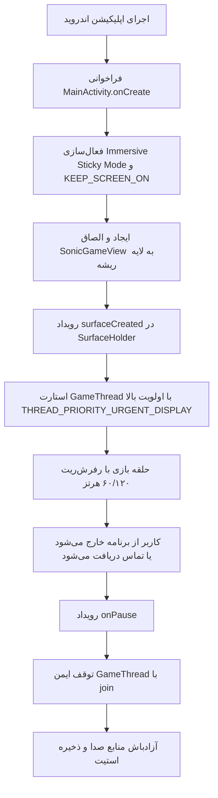

# فاز ۱: راه‌اندازی ساختار اندروید، Gradle و هوک‌های اکتیویتی (Engine Setup & Lifecycle)

## ۱. اهداف فاز ۱
- ایجاد ساختار استاندارد پروژه اندروید با زبان کاتلین (`build.gradle.kts`، `settings.gradle.kts`، `AndroidManifest.xml`).
- راه‌اندازی `MainActivity` با مد Immersive Sticky (حذف نوار وضعیت و کلیدهای ناوبری برای بازی فول‌اسکرین).
- پیاده‌سازی هوک‌های چرخه حیات اندروید (`onPause`، `onResume`، `onDestroy`) برای جلوگیری از مصرف باتری و نشت حافظه.
- ایجاد کلاس پایه `SonicGameView` مبتنی بر `SurfaceView` و رابط `SurfaceHolder.Callback`.

## ۲. استراتژی و فلوچارت فاز ۱

## ۳. خروجی‌های این فاز
- فایل‌های پیکربندی Gradle.
- فایل مانیفست اندروید با دسترسی‌های لازم و جهت‌گیری افقی اجباری (`android:screenOrientation="landscape"`).
- کلاس‌های `MainActivity.kt` و `SonicGameView.kt`.
