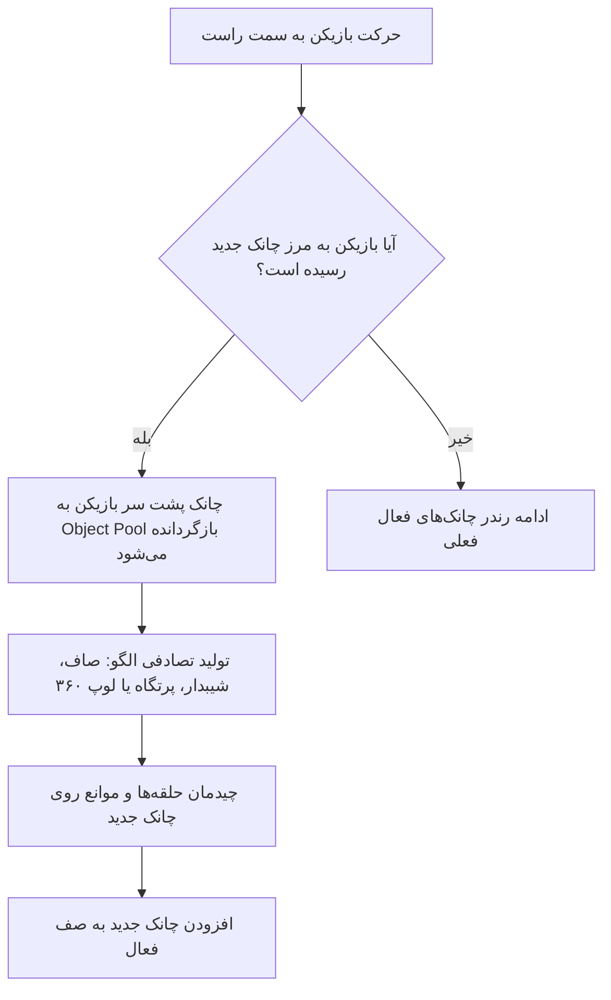

# فاز ۳: معماری مپ، چانک‌های ۱۲۸×۱۲۸ و استریمینگ نامحدود (Map & Chunks)

## ۱. اهداف فاز ۳
- طراحی فرمت چانک بر اساس معماری سگا (هر چانک ۱۲۸×۱۲۸ پیکسل متشکل از بلوک‌های ۱۶×۱۶).
- ذخیره ارتفاع هر بلوک (`HeightArray`) و زاویه سطح (`angleByte`).
- پیاده‌سازی `ChunkManager.kt` با سیستم بافر حلقوی (Circular Ring Buffer) برای استریم بی‌پایان مسیر.
- تولید خودکار شیب‌ها، ریل‌های هوایی، پرتگاه‌ها و لوپ‌های دایره‌ای.

## ۲. استراتژی و فلوچارت فاز ۳

## ۳. خروجی‌های این فاز
- `SonicChunk.kt`
- `BlockData.kt`
- `ChunkManager.kt`
