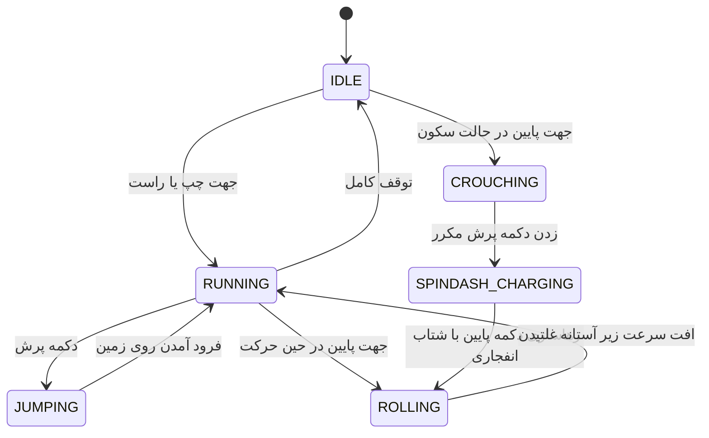

# فاز ۴: استیت‌های کاراکتر، انیمیشن و رندر نئونی (Character FSM & Graphics)

## ۱. اهداف فاز ۴
- پیاده‌سازی ماشین وضعیت محدود کاراکتر (`PlayerState.kt` و اینترفیس‌های حالات `Running`، `Jumping`، `Rolling`، `SpinDash`).
- پیاده‌سازی هیت‌باکس پویا (کاهش اندازه هیت‌باکس در حالت Roll و SpinDash از ۳۰×۴۰ به ۲۴×۲۴ پیکسل).
- پایپ‌لاین رندر سایبری نئونی: رندر خطوط ریل درخشان، سایه نورانی زیر کاراکتر و ذرات انرژی در سرعت‌های مافوق صوت.
- سیستم ذرات با بازیافت حافظه (`ParticlePool.kt`).

## ۲. استراتژی و فلوچارت فاز ۴

## ۳. خروجی‌های این فاز
- `SonicCharacter.kt`
- `PlayerState.kt`
- `ParticleSystem.kt`
