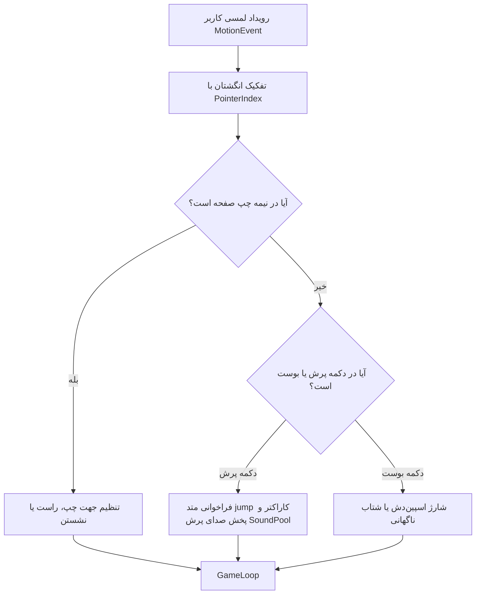

# فاز ۵: موتور صوت SoundPool، لایه ورودی چندلمسی و HUD اندروید (Audio & Touch HUD)

## ۱. اهداف فاز ۵
- پیاده‌سازی `TouchController.kt` با پردازش رویدادهای `MotionEvent` برای مالتی‌تاچ هم‌زمان (نگه داشتن جهت با یک انگشت و پرش با انگشت دیگر).
- بهینه‌سازی تاخیر لمسی (`ACTION_DOWN`، `ACTION_POINTER_DOWN`، `ACTION_UP`).
- طراحی `SonicAudioManager.kt` با استفاده از `SoundPool` نیتیو اندروید و صدای فرکانس بالای رینگ، پرش و اسپین‌دش.
- رندر HUD سایبری (امتیاز، زمان با دقت میلی‌ثانیه، تعداد رینگ و سرعت‌سنج بر حسب کیلومتر بر ساعت).

## ۲. استراتژی و فلوچارت فاز ۵

## ۳. خروجی‌های این فاز
- `TouchController.kt`
- `SonicAudioManager.kt`
- `HudRenderer.kt`
