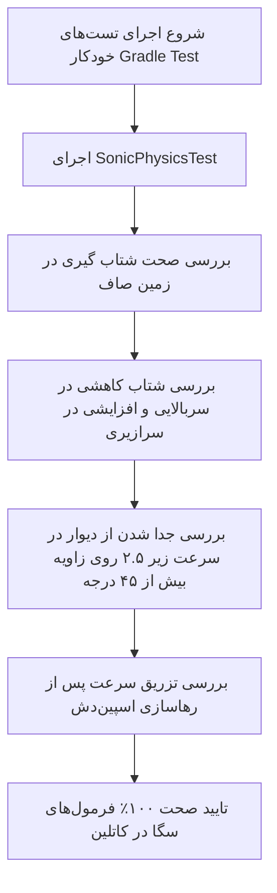

# فاز ۶: تست واحد، ارزیابی پروفایلر و مانیتورینگ کارایی (Testing & Profiling)

## ۱. اهداف فاز ۶
- پیاده‌سازی تست‌های واحد (Unit Tests) با JUnit 4/5 برای توابع محاسباتی فیزیک.
- تست راستی‌آزمایی معادلات شتاب، کاهش سرعت، آستانه لغزش در شیب‌های تند و پرش.
- تست عدم نشت حافظه در چرخه استریم چانک‌ها (Zero Allocation Verification).
- چک‌لیست پایداری ۶۰ فریم بر ثانیه روی دستگاه‌های میان‌رده و پرچم‌دار اندروید.

## ۲. استراتژی و فلوچارت فاز ۶

## ۳. خروجی‌های این فاز
- فایل تست `SonicPhysicsTest.kt`
- متدهای ارزیابی پروفایلر و گزارش عملکرد
